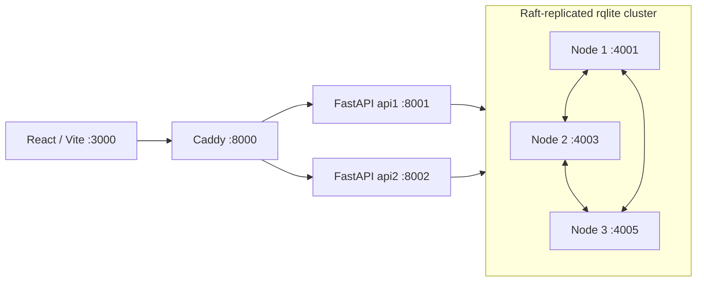

# RIHAISH — AI-based Property Intelligence Ecosystem

RIHAISH is an FYP prototype for property discovery and decision support in Pakistan, with a React interface, FastAPI services, and a real Raft-replicated relational database.

## The problem we address

A buyer comparing properties in Karachi, Lahore or Islamabad/Rawalpindi needs more than an asking price. They need to understand which records support a listing, where its price history came from, what facilities are nearby, and whether construction updates are current. Those questions involve different sources, different geographic contexts, and different levels of confidence.

RIHAISH's goal is to bring that information into a traceable workflow for buyers, investors, society operators and administrators. The product should distinguish source evidence, estimates and predictions so a polished interface does not imply facts that have not been verified.

## Our approach and current scope

- Search properties by city and text, apply numerical price filters, sort globally and paginate through SQL-backed results.
- Support account/login, JWT authorization, role checks, watchlists and administration through the existing API and role-specific screens.
- Present property/society information with price trajectories, facility-distance estimates, government-record fields and construction-update views.
- Keep relational data replicated across three rqlite voters, with two FastAPI instances behind Caddy.

The reliable distributed data layer is implemented and functionally verified. The intelligence modules and commercial workflows are a prototype.

## Architecture



All three database processes are voting members with separate stores. Leadership is elected dynamically. Each node replicates the full database; city-prefixed tables are **logical namespaces**, not independently hosted geographic shards. The current deployment runs on one Windows laptop and demonstrates process-failure tolerance, not independent-host or power-failure tolerance.

The adapter preserves parameterized SQL, commits buffered writes as a Raft transaction, performs linearizable reads, and does not silently fall back to SQLite when DDS storage is unavailable. Uncertain writes are not blindly replayed. Uniqueness constraints, atomic watchlist operations and conditional OTP consumption are retained.

A controlled ten-property query comparison reduced database HTTP calls from **42 to 3** with matching response hashes. This is a query-batching result, not a throughput or million-user benchmark. Historical failover evidence and operational detail remain in [the DDS runbook](docs/DDS_RUNBOOK.md).

## Technology

- React 18, React Router, Vite 6, Tailwind CSS, Recharts and Lucide.
- Python 3.12, FastAPI/Pydantic, Uvicorn, HTTPX, JWT and bcrypt.
- rqlite 10.6.5, Caddy 2.11.7; optional k6 2.3.0 for retained load tests.
- NumPy, pandas and scikit-learn dependencies support the prototype intelligence code. The current trajectory engine includes growth assumptions/backcasts.

## Local setup — Windows PowerShell

Prerequisites: Git, Python 3.12 and Node.js/npm. The checked environment used Python 3.12.6 and Node 24.18.0. Native DDS launchers bind to loopback. Docker/Render files are retained backend templates, not a verified three-node production deployment.

```powershell
git clone https://github.com/AbdullahKhan1298/Rihaish-AI-based-Property-Intelligence-Ecosystem.git
Set-Location Rihaish-AI-based-Property-Intelligence-Ecosystem
python -m venv .venv
.\.venv\Scripts\Activate.ps1
python -m pip install -r backend/requirements-windows.lock.txt
npm.cmd ci --prefix frontend
New-Item -ItemType Directory -Force .runtime,docs/evidence | Out-Null
```

The Windows lock records the installed dependency closure used for this baseline. The broader `backend/requirements.txt` remains available; other platforms and a fresh install of the locked environment are not yet independently validated.

For a **new clone only**, create local configuration without overwriting an existing key:

```powershell
if (-not (Test-Path backend/.env)) {
    Copy-Item backend/.env.example backend/.env
    python -c "import secrets; from pathlib import Path; p=Path('backend/.env'); p.write_text(p.read_text().replace('SECRET_KEY=', 'SECRET_KEY='+secrets.token_urlsafe(48), 1))"
}
```

An explicit `SECRET_KEY` is required. Keep an existing installation's key and password hashes unchanged. SMTP/Kaggle credentials are optional local configuration; mail delivery and external ingestion need their own verification. Never commit `.env`.

### Data setup for a fresh clone

This is a **source-only repository**. Original databases, rqlite stores, credentials, backups, raw scraped datasets and recorded response payloads are deliberately not distributed. A clone does not contain the retained working dataset.

Obtain authorized, consistent source snapshots from the project owner. The migration takes the four authoritative files (`auth_core.db` and three `shard_<city>_primary.db` files). Keep all seven original files/replicas when preserving an existing installation. For a genuinely new, empty cluster only:

```powershell
powershell -NoProfile -ExecutionPolicy Bypass -File scripts/install_dds_tools.ps1
powershell -NoProfile -ExecutionPolicy Bypass -File scripts/dds_cluster.ps1 -Action start
# Replace the path with your authorized quiesced snapshots; choose a NEW candidate filename.
python scripts/migrate_dds.py --source-dir YOUR_PRIVATE_SNAPSHOT_DIRECTORY --output .runtime/migration/first-import.db --import-empty-cluster
```

The migration refuses an occupied target. **Do not import again on the retained working machine.** If a write/import response is interrupted, inspect state rather than blindly retrying. Use `--verify-only` with a new candidate path for a read-only source/cluster comparison. Schema initialization and seeding are not performed by DDS API startup.

### Resume an existing migrated installation

Use its established Python environment so the owned-process launcher's executable checks remain consistent:

```powershell
powershell -NoProfile -ExecutionPolicy Bypass -File scripts/dds_cluster.ps1 -Action start
powershell -NoProfile -ExecutionPolicy Bypass -File scripts/dds_services.ps1 -Action start
Invoke-RestMethod http://127.0.0.1:8000/api/health/ready
```

In another terminal:

```powershell
Set-Location frontend
npm.cmd run dev -- --host 127.0.0.1 --port 3000 --strictPort
```

Open http://127.0.0.1:3000 and API documentation at http://127.0.0.1:8000/docs. Reuse healthy processes rather than launching duplicates. Do not run legacy `start_servers.bat` alongside DDS: its single API conflicts with Caddy's port.

SQLite is retained as an explicitly selected legacy/local mode; the DDS launchers always select `RIHAISH_DB_BACKEND=rqlite`.

## Verification

```powershell
# Isolated fixture tests: no retained user data is deleted.
python -m unittest discover -s tests -v
npm.cmd run build --prefix frontend

# Real non-disruptive checks, with authorized data and running services.
python scripts/verify_dds_smoke.py --frontend
python scripts/verify_dds_auth.py --output docs/evidence/fyp-auth.json

# Before committing/publishing: staged content plus all reachable Git history.
python scripts/check_publication.py --history
```


Do **not** run root `test_e2e_full.py` against retained data: it is a destructive historical test. Controlled real node-failure commands remain in the DDS runbook; they are not necessary for normal startup or every commit. The unchanged k6 runner is `scripts/run_k6.ps1`; preserve failed results and interpret actual completed-request counts before making acceptance claims.

## Known limitations and next milestone

- Sustained-load/large-burst qualification is open. Overload admission code is retained, with incomplete end-to-end overload acceptance.
- The current retained copy has 224 properties, 18 societies and 134 inherited missing society references. Search retains denormalized listings; joins to missing parents omit those records. These are development-data counts, not market traction.
- Legacy UI promotional counts, accuracy badges and government-verification language remain unvalidated copy. Styling, routes and frontend source were preserved in this milestone; those labels must not be presented as measured product results.
- Forecast quality, source licensing/provenance, government evidence, drive-time estimates, construction authenticity and full society/investor workflows require further validation. Billing is a prototype.
- Backend dependency ranges, permissive CORS, deployment hardening and test-client/build warnings need follow-up before production. Public source does not make the laptop deployment production-ready.

