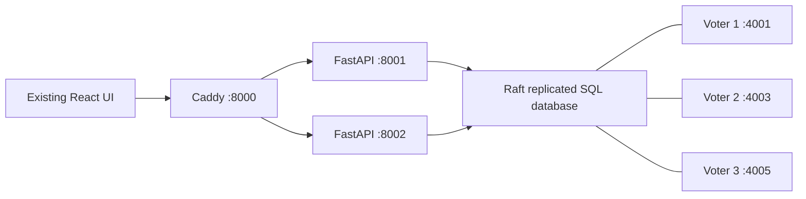

# RIHAISH DDS — five-minute evaluator presentation

Use this with the existing application and `DDS_RUNBOOK.md`. Show real output
from the commands; do not read old simulated-failover claims as results.

## 1. Existing application and current topology — 45 seconds

“RIHAISH retains its React interface, property APIs and JWT roles. Its original
local SQLite files are preserved. The evaluator mode uses one relational
database replicated by Raft across three independent Windows processes.”



Show `scripts/dds_cluster.ps1 -Action status` and the raw `/status` member
lists. State that all voters replicate all tables; city namespaces are logical
partitions. The laptop is one physical failure domain.

## 2. SQL behavior and preserved records — 45 seconds

Show the existing search screen, then query:

```powershell
Invoke-RestMethod 'http://127.0.0.1:8000/api/properties/?q=plot&min_price=1000000&max_price=10000000&sort=price_asc&page=1&page_size=10'
Invoke-RestMethod 'http://127.0.0.1:8000/api/properties/?sort=price_asc&page=2&page_size=10'
```

“Filtering, ordering and pagination execute in SQL. Totals cover all matching
rows, not only a page. We copied 224 properties and 18 societies. Migration
verification matched all 31 source tables; source-file hashes are preserved.”

## 3. Real writes, replication and failure — 90 seconds

Run `python scripts/verify_dds_live.py`. Explain the checks as they execute:

- A real row is committed before failure.
- Twelve simultaneous inserts target one unique database key: one succeeds,
  eleven are rejected by the database. A separate transaction rolls back on
  a uniqueness conflict.
- The script stops the actual leader process, observes a new leader, and
  performs a read and a new write with two voters online.
- With only one voter, quorum reads return HTTP 503.
- Stopped nodes restart from their retained stores. Every node's local copy
  must contain the write performed during failure.
- Only UUID-labelled records created by this run are cleaned up.

“The legacy button switched an in-memory flag between files. This test stops
real processes and relies on Raft election, quorum and log catch-up.”

## 4. Authentication and API balancing — 45 seconds

Run `python scripts/verify_dds_auth.py` and show its report, without displaying
passwords or tokens. It verifies real rqlite-backed buyer/admin login, JWTs on
both APIs, role restrictions, OTP concurrency and atomic watchlist operations.
The evaluation fixtures are clearly labelled and removed afterwards.

“The recovered source had zero users. We do not claim that existing accounts
were migrated. Both API instances use the same retained JWT configuration.”

For a hands-on UI login, `--keep-fixtures` saves private credentials under
`.runtime`; use `--cleanup` with that exact manifest after the demonstration.

## 5. Performance and limits — 75 seconds

Show `DDS_PERFORMANCE_REPORT.md` and the newest timestamped k6 summary.

“Batching reduced a ten-property city's database HTTP requests from 42 to 3,
with identical response content. The controlled route comparison improved from
356–542 ms to 32–40 ms. That is not a substitute for a load test.”

Run `scripts/run_k6.ps1 -Label evaluator`. Explain all original thresholds:
10 virtual users, 30 seconds, 0.1-second think time, rotating cities, ten-item
price-sorted SQL pages; failures below 1%, p95 below two seconds, over 99%
successful checks, and responses from both APIs. A run passes only if its
exit code and all thresholds pass. Show failures openly if the latest run
does not pass; do not present single-request latency as sustained capacity.

Finish with the known limits: one laptop cannot survive host failure; 134
source properties refer to missing society parents, so society joins omit
those listings; real-world NOC assertions and model accuracy are not proved
by DDS testing. Original data has not been silently rewritten.

